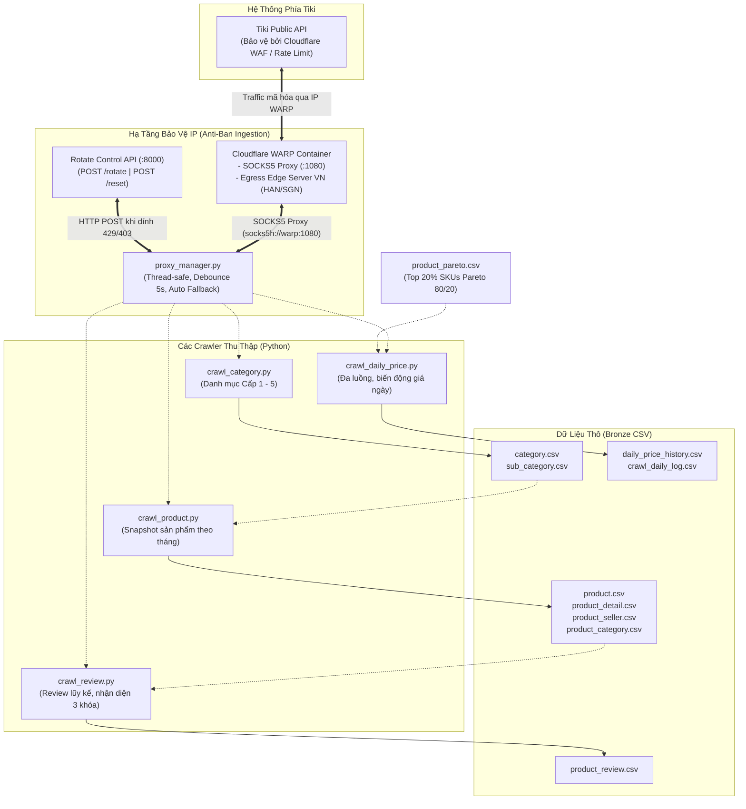

# Tầng Thu Thập Dữ Liệu Tiki (Bronze / Ingestion Layer)

Thư mục này chịu trách nhiệm thu thập toàn bộ dữ liệu thô từ hệ thống API công khai của sàn thương mại điện tử Tiki, tích hợp **Hạ tầng Cloudflare WARP SOCKS5 Proxy chống chặn IP (Anti-Ban IP)**, lưu trữ dữ liệu dưới dạng các tệp CSV có cấu trúc và sẵn sàng đồng bộ lên **MinIO Object Storage (prefix `current/bronze/`)**.

---

## 1. Cấu trúc và Kiến trúc Thu Thập Dữ Liệu



---

## 2. Danh Mục Các Script & Vai Trò Dữ Liệu

| Tập tin / Module | Đầu vào | Đầu ra (CSV) | Grain & Ý nghĩa nghiệp vụ |
|---|---|---|---|
| **`proxy_manager.py`** | Biến môi trường `WARP_PROXY_URL`, `WARP_CONTROL_URL` | Cấu hình proxy `requests.Session` & trigger đổi IP | **Trình điều phối kết nối mạng & Xoay IP**: Tự động cấu hình proxy SOCKS5, bắt mã lỗi HTTP 429/403 để kích hoạt đổi IP từ Cloudflare WARP. Hỗ trợ đa luồng và tự động chạy mạng thường khi chạy ngoài Docker. |
| **`category/crawl_category.py`** | Tiki Category API | `category.csv`<br/>`sub_category.csv` | **Danh mục sản phẩm**: Thu thập danh mục gốc (cấp 1) và đệ quy cây phân cấp danh mục con (cấp 1 đến cấp 5). Nguồn dữ liệu danh mục tĩnh, crawl khi khởi tạo hệ thống. |
| **`product/crawl_product.py`** | `category/category.csv` | `product.csv`<br/>`product_detail.csv`<br/>`product_seller.csv`<br/>`product_category.csv` | **Snapshot sản phẩm theo tháng (`YYYY-MM`)**:<br/>- `product.csv`: Cặp `(product_id, seller_product_id)`.<br/>- `product_detail.csv`: Thuộc tính chi tiết (SKU, brand, rating, sold).<br/>- `product_seller.csv`: Gian hàng, giá bán, cờ `is_best_store`.<br/>- `product_category.csv`: Cây breadcrumb phân loại ngành hàng. |
| **`daily_price/crawl_daily_price.py`<br/>`daily_price/recovery.py`** | `daily_price/product_pareto.csv` | `daily_price_history.csv`<br/>`crawl_daily_log.csv` *(tự sinh khi lỗi)* | **Lịch sử biến động giá theo ngày (`YYYY-MM-DD`)**: Thu thập giá của nhóm sản phẩm hạt nhân vật lý (Top 20% Pareto đóng góp 80% doanh thu, đã loại bỏ ngành hàng Voucher 11312). Chạy đa luồng (`ThreadPoolExecutor`), ghi nhận giá bán, giá niêm yết, discount và tồn kho. |
| **`review/crawl_review.py`** | `product/product_detail.csv`<br/>`product/product_seller.csv` | `product_review.csv` | **Đánh giá khách hàng lũy kế**: Nhận diện duy nhất bằng bộ 3 khóa kết hợp: `(review_id, product_id, seller_product_id)`. Quét theo thứ tự mới nhất, dừng sớm khi gặp đánh giá đã lưu. |

---

## 3. Cơ Chế Chống Chặn IP & Vận Hành Bền Bỉ (Fault Tolerance)

### A. Hạ tầng Cloudflare WARP SOCKS5 & Tự động đổi IP
Sàn Tiki áp dụng Cloudflare WAF và cơ chế Rate Limiting rất chặt chẽ đối với các IP gửi request liên tục:
1. **Lá chắn bảo vệ IP gốc**: Khi chạy trong Docker, toàn bộ traffic cào dữ liệu được định tuyến qua `socks5h://warp:1080`. Địa chỉ IP xuất hiện trên máy chủ Tiki là IP của Cloudflare (Edge HAN/SGN) chứ không phải IP mạng cá nhân/công ty của bạn.
2. **Cơ chế Tự Động Xoay IP khi gặp 429/403**:
   * Khi gặp `HTTP 429 Too Many Requests` hoặc `HTTP 403 Forbidden`, các crawler lập tức gọi hàm `rotate_ip()` trong [`proxy_manager.py`](proxy_manager.py).
   * Module gửi yêu cầu `POST http://warp:8000/rotate` tới container WARP để ngắt và thiết lập phiên kết nối WireGuard mới (nhận IP mới chỉ trong 2-3 giây).
   * Trường hợp cần làm mới định danh toàn diện, container hỗ trợ `POST http://warp:8000/reset` để đăng ký lại tài khoản WARP client mới.
3. **An toàn đa luồng (Thread-safe & Debounce)**:
   * `crawl_daily_price.py` chạy 3 luồng song song (`MAX_WORKERS = 3`). Khi cả 3 luồng cùng dính rate-limit đồng thời, `proxy_manager` áp dụng cơ chế khóa (`threading.Lock`) và khoảng thời gian hoãn (Cooldown 5 giây). Chỉ luồng đầu tiên kích hoạt xoay IP, các luồng sau đợi kết nối ổn định rồi retry, loại bỏ hiện tượng xoay IP dồn dập.
4. **Tương thích ngược (Zero-friction Fallback)**:
   * Nếu chạy script trực tiếp trên máy host không bật Docker WARP, module tự động nhận diện `WARP_PROXY_URL` không tồn tại và chuyển sang chạy mạng nội bộ bình thường, không gây ra bất kỳ lỗi runtime nào.

### B. Khả năng phục hồi và tiếp tục khi gián đoạn (Resumable Crawl)
* **Flush dữ liệu định kỳ**: Các crawler định kỳ ghi nối tiếp (`mode="a"`) dữ liệu từ bộ nhớ xuống đĩa (`SAVE_EVERY`), không sợ mất dữ liệu nếu container bị khởi động lại.
* **Đối soát khóa thông minh**: `crawl_daily_price.py` tự động đọc các khóa đã hoàn thành trong ngày từ `daily_price_history.csv` và danh sách lỗi từ `crawl_daily_log.csv`, chỉ tập trung crawl các sản phẩm còn thiếu.
* **Cơ chế dừng sớm (Early Stopping) cho Review**: `crawl_review.py` duyệt từ review mới nhất về cũ; ngay khi chạm vào review đã có trong kho dữ liệu, crawler tự động chuyển sang SKU tiếp theo, tiết kiệm hơn 80% số lượng request.

---

## 4. Điều Phối Qua Airflow (Dual-DAG Ingestion)

Các crawler được thực thi tự động thông qua adapter [`minio_task.py`](../04_orchestration/airflow/scripts/minio_task.py):

* **DAG Monthly (`tiki_product_monthly`)**:
  - Chạy lúc **02:00 ngày 1 hàng tháng**.
  - Thực thi: `crawl_product.py` quét toàn bộ danh mục và crawl chi tiết sản phẩm tháng mới (`execution_timeout=144h`).
* **DAG Daily (`tiki_extract_transform_load`)**:
  - **03:00**: `crawl_product.py` quét bổ sung SKU mới (tự động bỏ qua nếu DAG Monthly đang chạy).
  - **09:00**: `crawl_review.py` quét đánh giá mới phát sinh.
  - **14:00**: `crawl_daily_price.py` lượt crawl giá chính trong ngày.
  - **21:00**: `crawl_daily_price.py` đọc log lỗi ngày, crawl bù các sản phẩm chưa thành công.

Sau khi hoàn tất thu thập, adapter tính toán mã băm SHA-256 và đồng bộ các file CSV có thay đổi lên MinIO Bronze (`current/bronze/`), đồng thời sao lưu bản cũ vào `history/<run_id>/bronze/`.

---

## 5. Hướng Dẫn Chạy Thủ Công (Manual Execution)

Đứng tại thư mục gốc của repository (`TiKi-Analysic`):

```bash
# 1. Crawl danh mục (chạy một lần ban đầu)
python 01_craw_data/category/crawl_category.py

# 2. Crawl sản phẩm và chi tiết thuộc tính
python 01_craw_data/product/crawl_product.py

# 3. Crawl biến động giá hàng ngày (cần file product_pareto.csv)
python 01_craw_data/daily_price/crawl_daily_price.py

# 4. Crawl đánh giá khách hàng (cần product_detail và product_seller)
python 01_craw_data/review/crawl_review.py
```

> 💡 **Mẹo**: Nếu bạn muốn chạy thủ công trên máy host nhưng vẫn dùng proxy WARP, chỉ cần xuất biến môi trường trước khi chạy:
> ```bash
> # Linux/macOS
> export WARP_PROXY_URL="socks5h://127.0.0.1:1080"
> export WARP_CONTROL_URL="http://127.0.0.1:8000"
> 
> # PowerShell Windows
> $env:WARP_PROXY_URL="socks5h://127.0.0.1:1080"
> $env:WARP_CONTROL_URL="http://127.0.0.1:8000"
> ```
