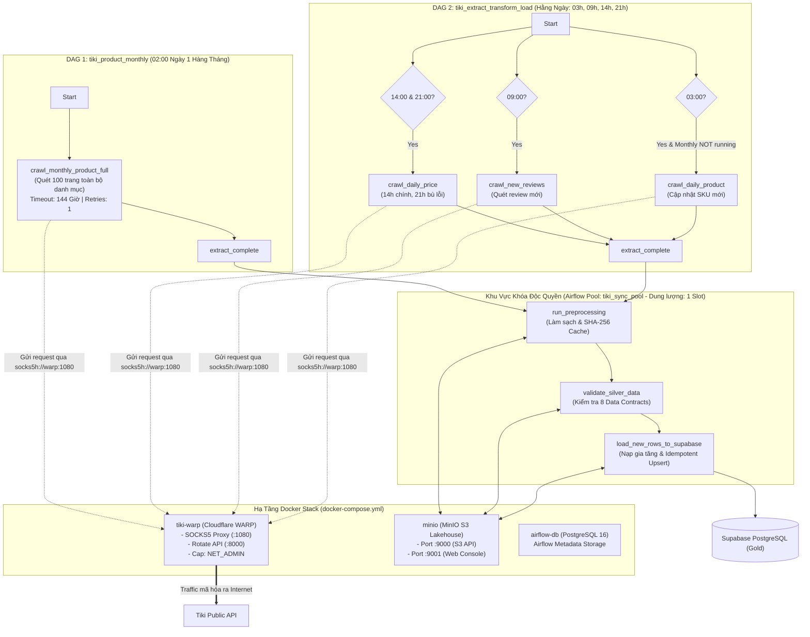
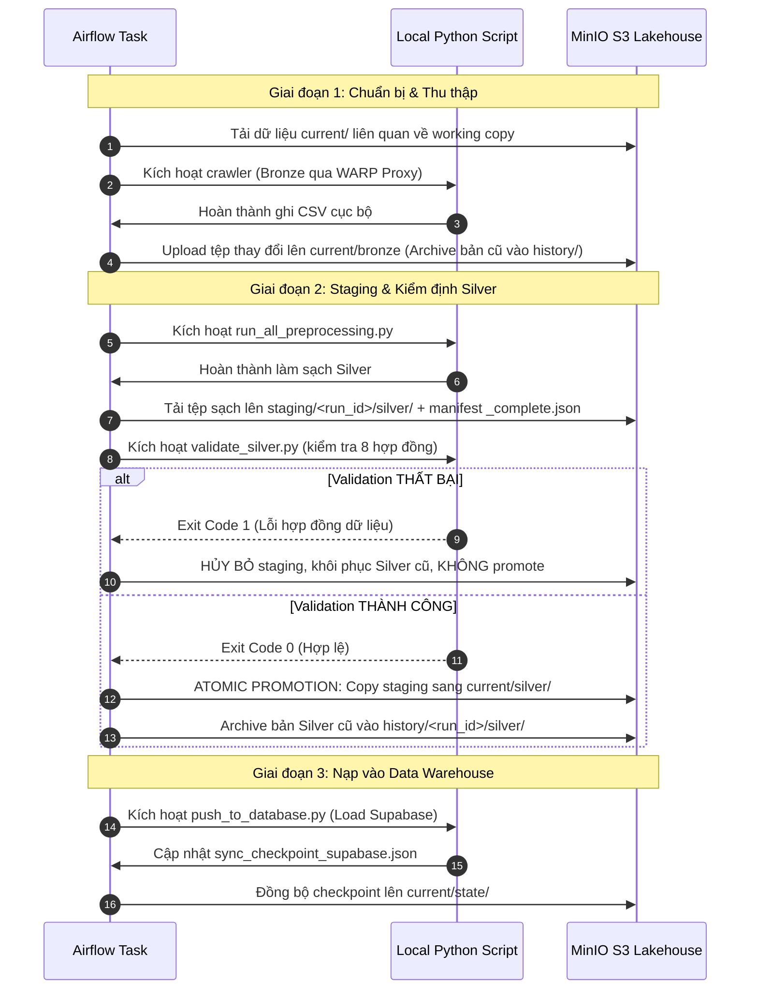

# Điều Phối Pipeline & Hạ Tầng Tự Động Hóa (Orchestration / Airflow, MinIO & WARP)

Thư mục này chứa toàn bộ cấu hình hạ tầng container hóa (**Docker Compose**), hệ thống lập lịch & điều phối quy trình tự động (**Apache Airflow 2.10.5**), hệ thống lưu trữ đối tượng dạng hồ dữ liệu (**MinIO S3 Lakehouse**), lá chắn proxy chống chặn IP (**Cloudflare WARP Anti-Ban Service**) và adapter đồng bộ dữ liệu thông minh ([`scripts/minio_task.py`](scripts/minio_task.py)).

---

## 1. Kiến Trúc Điều Phối Tổng Thể (Orchestration Architecture)

Hệ thống được thiết kế theo mô hình **Dual-DAG Architecture** kết hợp với **Airflow Pool (1 slot)** và **WARP Proxy Service** nhằm giải quyết 3 bài toán kỹ thuật trọng tâm:
1. **Chống nghẽn & Chống chặn IP sàn TMĐT**: Tự động định tuyến traffic cào dữ liệu qua Cloudflare WARP và tự xoay IP khi bị giới hạn tần suất (HTTP 429/403).
2. **Khắc phục thời gian crawl lớn**: Tách riêng DAG cào tổng thể theo tháng (144h timeout) và DAG cào gia tăng theo ngày.
3. **Triệt tiêu xung đột tài nguyên (Race Condition)**: Sử dụng Airflow Pool (1 slot) khóa độc quyền các task nạp dữ liệu lên MinIO và Supabase PostgreSQL.



---

## 2. Chi Tiết Lập Lịch & Phân Bổ Tác Vụ (Scheduling Rules)

Tất cả các mốc thời gian đều được cấu hình theo giờ Việt Nam (**`Asia/Ho_Chi_Minh`**, UTC+7):

### 1. DAG `tiki_product_monthly` (Chạy đầu tháng)
* **Lịch kích hoạt**: `0 2 1 * *` (02:00 sáng ngày 1 hàng tháng).
* **Mục tiêu**: Quét sâu toàn bộ danh mục và crawl chi tiết tất cả sản phẩm đang lưu hành trên sàn trong tháng đó.
* **Thời gian thực thi tối đa (Execution Timeout)**: **144 giờ (6 ngày)**, `retries = 1` (exponential backoff 30 phút). Nhờ cơ chế batch flush và checkpoint trong `crawl_product.py`, nếu container khởi động lại thì task sẽ tiếp tục từ mốc đã dừng chứ không crawl lại từ đầu.
* **Chuỗi tác vụ**: `crawl_monthly_product_full >> run_preprocessing >> validate_silver_data >> load_new_rows_to_supabase`.

### 2. DAG `tiki_extract_transform_load` (Pipeline hằng ngày)
* **Lịch kích hoạt**: `0 3,9,14,21 * * *` (Chạy vào các mốc 03:00, 09:00, 14:00 và 21:00).
* **Phân bổ khung giờ**:
  * **03:00 – `crawl_daily_product`**: Quét bổ sung sản phẩm mới xuất hiện. Tự động kiểm tra trạng thái qua `is_monthly_crawl_running()`: nếu DAG monthly đang chạy thì task này sẽ **Skip** để không tranh chấp băng thông/IP.
  * **09:00 – `crawl_new_reviews`**: Crawl các đánh giá mới phát sinh cho các sản phẩm hiện có.
  * **14:00 – `crawl_daily_price`**: Lượt thu thập biến động giá chính trong ngày.
  * **21:00 – `crawl_daily_price`**: Lượt rà soát cuối ngày, đọc log lỗi của lượt 14h và crawl bù các SKU/biến thể còn thiếu vào cùng tệp lịch sử.
* **Chuỗi tác vụ sau crawl**: `extract_complete >> run_preprocessing >> validate_silver_data >> load_new_rows_to_supabase`.

---

## 3. Các Dịch Vụ Trong Docker Stack (`docker-compose.yml`)

Stack Docker được thiết lập khép kín, tối ưu tài nguyên:

| Service | Image | Vai trò & Cấu hình kỹ thuật |
|---|---|---|
| **`warp`** | `tiki-warp:local`<br/>*(Custom build từ `04_orchestration/warp`)* | **Lá chắn chống chặn IP & SOCKS5 Proxy**:<br/>- Khởi tạo daemon `cloudflare-warp` ở chế độ SOCKS5 proxy tại cổng `1080`.<br/>- Cung cấp mini REST API tại cổng `8000` (`POST /rotate`, `GET /status`).<br/>- Cấu hình quyền `cap_add: [NET_ADMIN]` và mount thiết bị `/dev/net/tun`.<br/>- Healthcheck tự động giám sát trạng thái kết nối tới Cloudflare edge. |
| **`airflow-db`** | `postgres:16` | Cơ sở dữ liệu chuyên biệt lưu trữ metadata, DAG runs, task instances và pools của Airflow. Hoàn toàn tách biệt với Supabase PostgreSQL. |
| **`minio`** | `quay.io/minio/aistor/minio:latest` | Hệ thống lưu trữ đối tượng tương thích AWS S3. Cung cấp API tại cổng `9000` và giao diện Web Console tại cổng `9001`. |
| **`airflow-init`** | `tiki-airflow:local`<br/>*(Custom build từ Dockerfile)* | Container khởi tạo: tự động chạy `airflow db migrate`, tạo tài khoản Admin, và thiết lập Airflow Pool `tiki_sync_pool (1 slot)`. |
| **`airflow-webserver`** | `tiki-airflow:local` | Giao diện quản trị đồ họa Airflow Web UI tại cổng `8080`. Phụ thuộc: `warp` (healthy), `minio` (started), `airflow-init` (completed). |
| **`airflow-scheduler`** | `tiki-airflow:local` | Trình giám sát và kích hoạt các DAG theo lịch cron. Phụ thuộc: `warp` (healthy), `minio` (started), `airflow-init` (completed). |

---

## 4. Cơ Chế MinIO Adapter & Atomic Promotion

Tệp [`scripts/minio_task.py`](scripts/minio_task.py) đóng vai trò là tầng trung gian (Adapter) giữa thư mục làm việc cục bộ của các container và MinIO S3 Lakehouse:



### Điểm mạnh kiến trúc của Adapter:
1. **Kiểm tra tính toàn vẹn bằng SHA-256**: Chỉ upload tệp khi mã băm nội dung thực sự thay đổi.
2. **Atomic Staging & Rollback**: Dữ liệu Silver chưa được kiểm định sẽ nằm ở vùng `staging/`. Nếu `validate_silver.py` phát hiện bất kỳ lỗi nào (sai format, duplicate key, rỗng), adapter tự động rollback về trạng thái sạch trước đó và hủy bỏ đợt staging.
3. **Sao lưu lịch sử đầy đủ (Audit Trail)**: Mỗi khi ghi đè một đối tượng trong `current/`, bản ghi cũ sẽ được copy lưu trữ tại `history/<run_id>/...` phục vụ truy vết và khôi phục khi cần thiết.

---

## 5. Hướng Dẫn Cài Đặt & Vận Hành Từ Đầu

### Bước 1: Chuẩn bị tệp cấu hình `.env`
Đứng tại thư mục `04_orchestration/airflow/`:

```bash
# Windows Command Prompt
copy .env.example .env

# Hoặc PowerShell / Bash
cp .env.example .env
```

Mở tệp `.env` và thiết lập các biến môi trường:
* `AIRFLOW_ADMIN_USER` & `AIRFLOW_ADMIN_PASSWORD`: Tài khoản đăng nhập Airflow UI.
* `AIRFLOW_DB_PASSWORD`: Mật khẩu cho Postgres metadata nội bộ.
* `AIRFLOW_FERNET_KEY`: Khóa mã hóa bảo mật của Airflow (tạo nhanh bằng lệnh Python phía dưới).
* `AIRFLOW_SECRET_KEY`: Khóa bí mật cho Webserver session.
* `MINIO_ROOT_USER` & `MINIO_ROOT_PASSWORD`: Tài khoản quản trị MinIO.
* `MINIO_ACCESS_KEY` & `MINIO_SECRET_KEY`: Cặp khóa truy cập ứng dụng tạo trên MinIO Console.
* `SUPABASE_DB_URL`: Chuỗi kết nối PostgreSQL đến Supabase có bật `sslmode=require`.

> 🔑 **Tạo Fernet Key nhanh bằng Python:**
> ```bash
> python -c "import base64,secrets; print(base64.urlsafe_b64encode(secrets.token_bytes(32)).decode())"
> ```

### Bước 2: Chuẩn bị giấy phép MinIO License
* Đặt tệp license hợp lệ vào đường dẫn `04_orchestration/airflow/minio.license` (được mount chế độ read-only vào container MinIO).

### Bước 3: Khởi động hệ thống Docker
```bash
# 1. Build image tùy chỉnh (bao gồm tiki-airflow và tiki-warp)
docker compose build

# 2. Khởi tạo database và pool
docker compose up airflow-init

# 3. Chạy toàn bộ các dịch vụ dưới nền
docker compose up -d

# 4. Kiểm tra trạng thái hoạt động của các container
docker compose ps
```

* **Airflow Web UI**: [http://localhost:8080](http://localhost:8080)
* **MinIO Console**: [http://localhost:9001](http://localhost:9001)

### Bước 4: Bootstrap Dữ Liệu Ban Đầu Lên MinIO
Sau khi tạo bucket (mặc định: `tiki-lake`) trên MinIO Console, thực hiện seed dữ liệu khởi tạo:

```bash
docker compose run --rm airflow-webserver python /opt/tiki/project/04_orchestration/airflow/scripts/minio_task.py bootstrap
```

---

## 6. Hướng Dẫn Kích Hoạt Thủ Công (Trigger with Config)

Trên Airflow UI, chọn DAG ➔ nhấn nút **Trigger DAG w/ config** và nhập JSON tương ứng:

```json
{"task": "daily_price"}
```

Các giá trị `task` hợp lệ:
* `daily_price`: Chỉ chạy luồng crawl giá hàng ngày (qua proxy WARP) ➔ transform ➔ validate ➔ load.
* `product`: Chỉ chạy luồng crawl sản phẩm ➔ transform ➔ validate ➔ load.
* `review`: Chỉ chạy luồng crawl review ➔ transform ➔ validate ➔ load.
* `preprocess`: Chạy làm sạch dữ liệu ➔ validate ➔ load.
* `push`: Kiểm tra và nạp dữ liệu sạch vào Supabase PostgreSQL.

Hoặc kích hoạt nhanh qua dòng lệnh terminal:
```bash
docker compose exec airflow-scheduler airflow dags trigger --conf "{\"task\":\"daily_price\"}" tiki_extract_transform_load
```

---

## 7. Các Lệnh Quản Trị & Khắc Phục Sự Cố Thường Gặp

```bash
# Xem log trực tiếp của proxy WARP (kiểm tra trạng thái kết nối & xoay IP)
docker compose logs -f warp

# Kiểm tra trạng thái IP hiện tại của container WARP
docker compose exec warp curl -s http://127.0.0.1:8000/status

# Yêu cầu xoay IP thủ công qua API
docker compose exec warp curl -X POST http://127.0.0.1:8000/rotate

# Xem log trực tiếp của scheduler
docker compose logs -f airflow-scheduler

# Xem log trực tiếp của webserver
docker compose logs -f airflow-webserver

# Xem log dịch vụ lưu trữ MinIO
docker compose logs -f minio

# Liệt kê danh sách DAG và kiểm tra lỗi cú pháp (Import Errors)
docker compose exec airflow-scheduler airflow dags list-import-errors

# Dừng hệ thống nhưng vẫn bảo lưu toàn bộ dữ liệu (Volumes)
docker compose down
```

> ⚠️ **Lưu ý an toàn:** Tuyệt đối không dùng lệnh `docker compose down -v` trừ khi bạn thực sự muốn xóa sạch toàn bộ metadata của Airflow và toàn bộ dữ liệu hồ MinIO!
