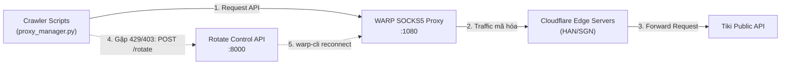

# Lá Chắn Chống Chặn IP (Cloudflare WARP Anti-Ban SOCKS5 Proxy)

Thư mục này chứa toàn bộ cấu hình đóng gói container Docker cho **Cloudflare WARP Client**, cung cấp giải pháp vượt rào cản kiểm soát tần suất (Rate Limiting) và chống khóa IP từ máy chủ Tiki/Cloudflare WAF.

---

## 1. Cơ Chế Hoạt Động



1. **Che giấu địa chỉ IP gốc**: Mọi request thu thập dữ liệu từ các crawler trong Docker đều được chuyển tiếp qua cổng proxy SOCKS5 nội bộ `socks5h://warp:1080`. Địa chỉ IP đích mà sàn Tiki ghi nhận thuộc dải IP Anycast của Cloudflare Edge (khu vực Hà Nội / TP.HCM), bảo vệ an toàn tuyệt đối cho IP mạng của bạn.
2. **Xoay IP tự động (Dynamic IP Rotation)**: Một tiến trình HTTP daemon siêu nhẹ ([`rotate_api.py`](rotate_api.py)) chạy tại cổng `8000`, lắng nghe lệnh điều khiển từ các crawler. Khi phát hiện mã lỗi `HTTP 429 Too Many Requests` hoặc `HTTP 403 Forbidden`, crawler tự động kích hoạt đổi IP tức thời chỉ trong 2–3 giây.

---

## 2. Danh Mục Các Tệp Trong Thư Mục

| Tệp tin | Vai trò & Chức năng |
|---|---|
| **`Dockerfile`** | Cài đặt `cloudflare-warp` và `curl` trên nền Ubuntu 22.04 LTS; cấu hình môi trường khởi chạy daemon và API điều khiển. |
| **`entrypoint.sh`** | Script khởi động container: Khởi tạo daemon `warp-svc`, chấp nhận điều khoản TOS, thiết lập chế độ SOCKS5 proxy tại cổng `1080`, đăng ký client ID mới và kích hoạt `rotate_api.py`. |
| **`rotate_api.py`** | Server HTTP Python thuần túy (không phụ thuộc framework ngoài) cung cấp REST API điều khiển xoay IP và kiểm tra trạng thái kết nối. |

---

## 3. Các Endpoint Của Rotate Control API (Port 8000)

| Phương thức | Endpoint | Chức năng | Phản hồi mẫu (JSON) |
|:---:|---|---|---|
| **`GET`** | `/status` | Kiểm tra trạng thái kết nối WARP và lấy địa chỉ IP công khai hiện tại. | `{"status": "Connected", "ip": "104.28.x.x"}` |
| **`POST`** | `/rotate` | Ngắt và kết nối lại phiên WireGuard để nhận địa chỉ IP mới (thời gian xử lý ~2s). | `{"success": true, "message": "Rotated IP", "new_ip": "104.28.y.y"}` |
| **`POST`** | `/reset` | Đăng ký tài khoản WARP mới hoàn toàn (`warp-cli registration new`) khi cần đổi dải mạng. | `{"success": true, "message": "Registration reset", "new_ip": "104.28.z.z"}` |

---

## 4. Cấu Hình Docker Compose

Trong [`04_orchestration/airflow/docker-compose.yml`](../airflow/docker-compose.yml), service `warp` yêu cầu quyền can thiệp giao diện mạng:

```yaml
  warp:
    build:
      context: ../warp
    image: tiki-warp:local
    restart: unless-stopped
    cap_add:
      - NET_ADMIN          # Quyền quản trị mạng để tạo interface ảo WireGuard (Cloudflare WARP)
    devices:
      - /dev/net/tun:/dev/net/tun  # Thiết bị TUN/TAP bắt buộc cho WireGuard
    environment:
      - WARP_PORT=1080     # Cổng proxy SOCKS5
      - API_PORT=8000      # Cổng điều khiển xoay IP
    healthcheck:
      test: ["CMD", "curl", "-fsS", "http://127.0.0.1:8000/status"]
      interval: 10s
      timeout: 5s
      retries: 5
```

---

## 5. Kiểm Tra Thủ Công

Từ máy host (nếu port được expose) hoặc từ bên trong một container trong cùng mạng Docker:

```bash
# 1. Kiểm tra trạng thái kết nối và IP hiện tại
curl http://localhost:8000/status

# 2. Thử nghiệm gửi request qua SOCKS5 Proxy
curl -x socks5h://localhost:1080 https://api.ipify.org?format=json

# 3. Kích hoạt lệnh đổi IP ngay lập tức
curl -X POST http://localhost:8000/rotate
```
