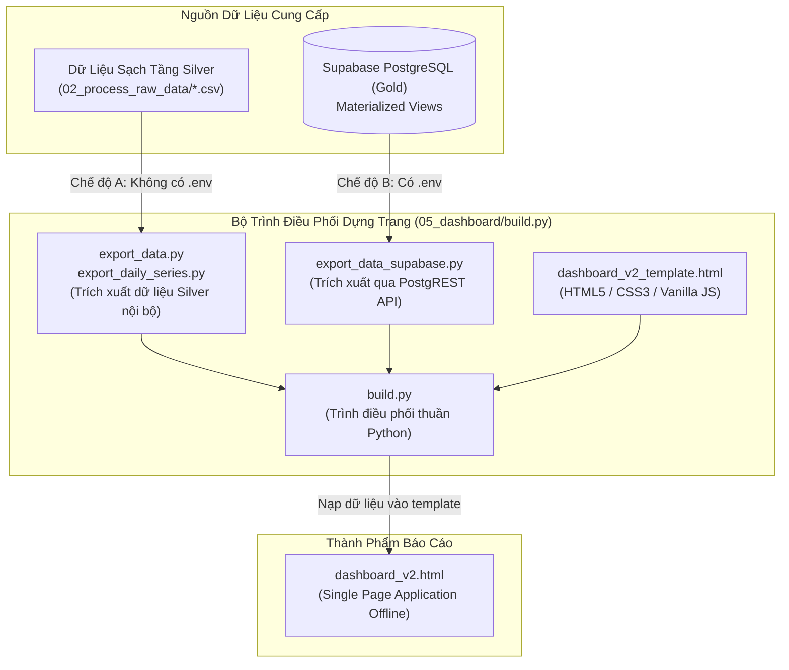

# Giao Diện Trực Quan Hóa Dữ Liệu (BI / Presentation Layer)

Thư mục này cung cấp hệ thống báo cáo phân tích kinh doanh thông minh dưới dạng **Interactive Web Dashboard (Single Page Application - SPA)**. Toàn bộ dữ liệu được tổng hợp và nhúng trực tiếp vào tệp HTML duy nhất (`dashboard_v2.html`) trong quá trình build bằng **Python thuần túy**, cho phép người dùng mở xem trực tiếp trên mọi trình duyệt web (Windows, Linux, macOS) mà không cần cài đặt web server hay dịch vụ backend phức tạp.

---

## 1. Kiến Trúc Dựng Dashboard (Build Architecture)



---

## 2. Chi Tiết 5 Màn Hình Báo Cáo Quản Trị

Dashboard được thiết kế theo chuẩn phân tích BI hiện đại, phục vụ trực tiếp cho 5 câu hỏi kinh doanh chiến lược:

| Tab Báo Cáo | Mục Tiêu Phân Tích | Các Chỉ Số & Biểu Đồ Trọng Tâm |
|---|---|---|
| **00 · Tổng quan (Overview)** | Bức tranh toàn cảnh hoạt động kinh doanh trên sàn | - 5 KPI Cards: Doanh số ước tính, Lượng bán lũy kế, Tỷ lệ giảm giá trung bình (ASP), Điểm đánh giá TB toàn sàn, Số lượng sản phẩm.<br/>- Biểu đồ phân bổ tỷ trọng theo Top 10 ngành hàng chủ lực. |
| **01 · Thị trường (Market & Category Share)** | Phân tích cơ cấu sản phẩm và quy luật Pareto 80/20 | - **Đường cong Pareto 80/20**: Minh chứng 1,54% sản phẩm mang lại 80% sản lượng tiêu thụ.<br/>- Cơ cấu doanh thu & sản lượng theo 4 phân khúc giá (Dưới 100k, 100k-500k, 500k-2tr, Trên 2tr).<br/>- Tỷ lệ sản phẩm "đuôi dài" chưa phát sinh đơn hàng (36,7%). |
| **02 · Hành vi & Giá bán (Pricing Elasticity & 1P vs 3P)** | Đánh giá hiệu quả giảm giá & Cạnh tranh gian hàng | - Tương quan giữa độ sâu giảm giá (`discount_rate`) và sản lượng bán trung bình.<br/>- So sánh thị phần, chênh lệch giá và tỷ lệ thắng Buy Box (`is_best_store`) giữa **Tiki Trading (1P)** và **Nhà bán sàn (3P)**. |
| **03 · Đánh giá & Tiếng nói KH (Customer Sentiment & Trust)** | Chất lượng dịch vụ & Rủi ro trải nghiệm khách hàng | - Phân bổ điểm số 1★ đến 5★.<br/>- Danh sách **107 SKU bán chạy nhưng điểm thấp (< 4★)** cần gắn cờ đối soát chất lượng.<br/>- Tác động của đánh giá có hình ảnh và xác thực "Đã mua hàng" đối với mức độ tin cậy. |
| **04 · Xu hướng biến động giá (Daily Price Trends & Seasonality)** | Chuỗi thời gian giá theo ngày & Sự kiện Mega Sale | - Chuỗi thời gian trượt theo ngày (tự động cập nhật dải ngày mới nhất).<br/>- Đường trung bình động MA-7 (Moving Average 7 ngày).<br/>- Phân tích hiệu ứng biến động giá và lượng mua trong chiến dịch Mega Sale 11/11. |

---

## 3. Cách Khởi Chạy & Dựng Dashboard

Hệ thống hỗ trợ chạy trên mọi nền tảng thông qua lệnh Python chuẩn:

```bash
# Chạy tạo dashboard và tự động mở trình duyệt xem báo cáo:
python 05_dashboard/build.py

# Thêm cờ --no-open nếu chạy ngầm / automated script:
python 05_dashboard/build.py --no-open
```
> Trên Windows, bạn vẫn có thể nhấp đúp hoặc chuột phải vào `build.ps1` chọn **"Run with PowerShell"** (script này đóng vai trò wrapper gọi thẳng `build.py`).

### Chế độ A: Dùng dữ liệu CSV nội bộ (Mặc định khi KHÔNG có file `.env`)
* **Khi nào dùng**: Chạy trên máy cá nhân, đang phát triển offline, hoặc không có tài khoản/khóa API của Supabase.
* **Cơ chế**: `build.py` tự động kích hoạt `export_data.py` và `export_daily_series.py` để đọc dữ liệu sạch trực tiếp từ thư mục `02_process_raw_data/`.
* Không yêu cầu bất kỳ kết nối mạng hay khóa bí mật nào.

### Chế độ B: Dùng dữ liệu trực tuyến từ Supabase (Khi CÓ file `.env`)
* **Khi nào dùng**: Khi cần đồng bộ dữ liệu mới nhất được nạp tự động qua pipeline Supabase đám mây.
* **Các bước thiết lập**:
  1. Tạo file `.env` từ mẫu `.env.example`:
     ```env
     SUPABASE_URL=https://<project-ref>.supabase.co
     SUPABASE_KEY=sb_publishable_... (hoặc anon key công khai)
     ```
     *(Lưu ý: Chỉ dùng anon key công khai, tuyệt đối không dùng secret key).*
  2. Đảm bảo các View trong `sql/supabase_views.sql` đã được khởi tạo trên Supabase.
  3. Chạy `python 05_dashboard/build.py`. Script sẽ gọi `export_data_supabase.py` để lấy dữ liệu qua PostgREST API.

Sau khi build hoàn tất, file `dashboard_v2.html` được tạo ra hoàn chỉnh (khoảng ~5.3 MB) và tự động mở trên trình duyệt mặc định.

---

## 4. Cấu Trúc Thư Mục Chi Tiết

```text
05_dashboard/
├── build.py                       # Trình điều phối build Dashboard chính bằng Python
├── build.ps1                      # PowerShell wrapper tiện ích cho môi trường Windows
├── dashboard_v2_template.html     # Khung mẫu giao diện HTML5/CSS3/Vanilla JS
├── dashboard_v2.html              # Thành phẩm SPA sau build (mở xem trực tiếp offline)
├── README.md                      # Tài liệu hướng dẫn sử dụng
├── .env.example                   # Mẫu khai báo biến môi trường Supabase
├── .gitignore
│
├── scripts/                       # Bộ script trích xuất & xử lý dữ liệu (100% Python)
│   ├── export_data.py             # Trích xuất dữ liệu từ các file CSV local tầng Silver
│   ├── export_daily_series.py     # Trích xuất & mã hóa chuỗi thời gian theo ngày động
│   └── export_data_supabase.py    # Trích xuất trực tuyến từ Supabase REST API
│
└── sql/                           # Định nghĩa View & Lập lịch trên Supabase
    ├── supabase_views.sql         # DDL tạo View và Materialized Views tối ưu cho Dashboard
    └── supabase_schedule_refresh.sql # Lịch cron pg_timetable tự động làm mới view
```
