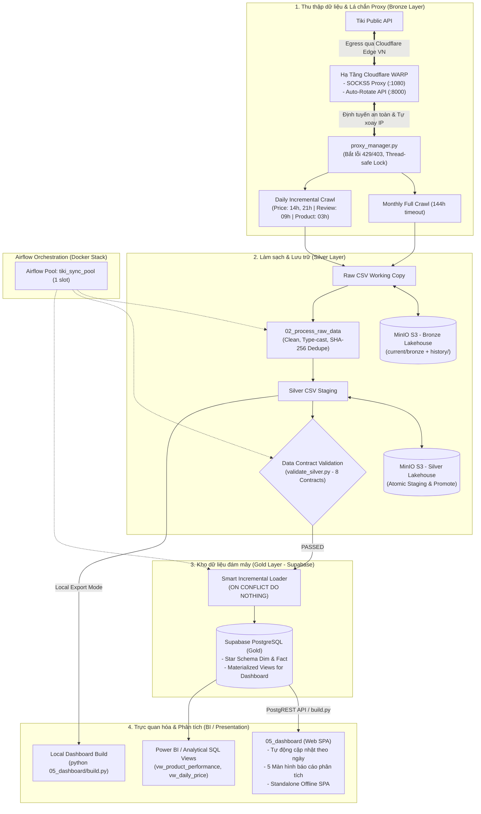
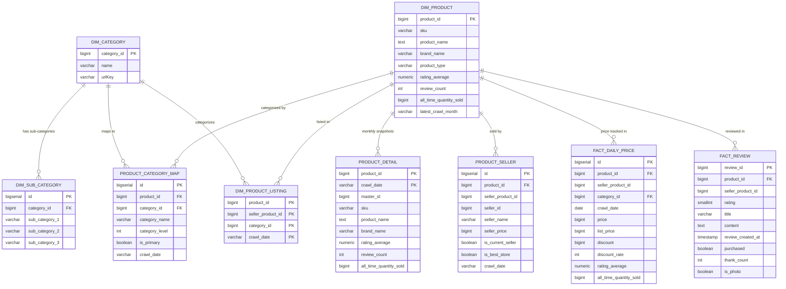

# 🛍️ Tiki E-Commerce Analytics: End-to-End Pipeline & Business Intelligence

> **Đề tài:** Nghiên cứu Hành vi tiêu dùng & Biến động giá trên sàn TMĐT Tiki  
> **Học phần:** IS383.1 - Khai phá dữ liệu và Phân tích kinh doanh | **Nhóm 1 - Trường Đại học Thăng Long**

[](https://www.python.org/)
[](https://supabase.com/)
[](https://airflow.apache.org/)
[](https://min.io/)
[](04_orchestration/warp/)
[](05_dashboard/)
[](tests/)
[](02_process_raw_data/validate_silver.py)

Dự án phân tích dữ liệu thương mại điện tử Tiki toàn diện (**End-to-End Analytics Portfolio Project**): Thu thập dữ liệu thô tự động từ Tiki Public API qua **Lá chắn proxy chống chặn IP Cloudflare WARP**, làm sạch & kiểm định chất lượng theo kiến trúc Medallion (Bronze ➔ Silver ➔ Gold), lưu trữ Data Lakehouse (MinIO S3 + Supabase PostgreSQL), điều phối tự động bằng Apache Airflow và trực quan hóa phân tích chiến lược kinh doanh qua **Interactive Web Dashboard SPA** cùng các Analytical Views chuẩn hóa.

---

## 📑 Mục lục (Table of Contents)
* [1. Bài toán kinh doanh & Mục tiêu phân tích (Business Problem)](#1-bài-toán-kinh-doanh--mục-tiêu-phân-tích-business-problem)
* [2. Phát hiện cốt lõi & Khuyến nghị hành động (Key Insights & Actionable Recommendations)](#2-phát-hiện-cốt-lõi--khuyến-nghị-hành-động-key-insights--actionable-recommendations)
* [3. Kiến trúc hệ thống (Medallion & Lakehouse Architecture)](#3-kiến-trúc-hệ-thống-medallion--lakehouse-architecture)
* [4. Mô hình dữ liệu chuẩn Star Schema & Analytical Views](#4-mô-hình-dữ-liệu-chuẩn-star-schema--analytical-views)
* [5. Cấu trúc thư mục dự án & Tài liệu chi tiết từng module](#5-cấu-trúc-thư-mục-dự-án)
* [6. Lập lịch điều phối & Hạ tầng Docker (Airflow, MinIO & Cloudflare WARP)](#6-lập-lịch-điều-phối--hạ-tầng-docker-airflow-minio--cloudflare-warp)
* [7. Trực quan hóa & Interactive Web Dashboard (Module 05)](#7-trực-quan-hóa--interactive-web-dashboard-module-05)
* [8. Hướng dẫn cài đặt & Khởi chạy nhanh (Setup & Verification)](#8-hướng-dẫn-cài-đặt--khởi-chạy-nhanh)
* [9. Bảng quy chuẩn 8 Hợp đồng Dữ liệu (Data Contracts)](#9-bảng-quy-chuẩn-8-hợp-đồng-dữ-liệu-data-contracts)
* [10. Kỹ năng nổi bật thể hiện trong dự án (Skills Showcase)](#10-kỹ-năng-nổi-bật-thể-hiện-trong-dự-án-skills-showcase)

---

## 1. Bài toán kinh doanh & Mục tiêu phân tích (Business Problem)

Thương mại điện tử Việt Nam cạnh tranh khốc liệt về **giá bán, khuyến mãi và chất lượng dịch vụ**. Dự án này được xây dựng nhằm giải quyết 5 câu hỏi quản trị kinh doanh then chốt của sàn thương mại điện tử:

1. **Quy luật Pareto (80/20) trong ngành hàng & sản phẩm**: Những danh mục và thương hiệu nào đang đóng góp 80% tổng sản lượng và doanh số ước tính? Tỷ trọng sản phẩm "đuôi dài" (long-tail) chưa phát sinh lượt bán là bao nhiêu?
2. **Hiệu quả của chiến lược giảm giá (Discount Elasticity)**: Mức giảm giá sâu (>30% hoặc >50%) có thực sự thúc đẩy sản lượng bán ra, hay chỉ làm xói mòn biên lợi nhuận của nhà bán hàng?
3. **Cạnh tranh giữa Gian hàng chính hãng (Tiki Trading - 1P) và Đối tác sàn (3P Sellers)**: Tỷ trọng thị phần, chênh lệch giá bán và tỷ lệ chiếm lĩnh hộp mua hàng (Buy Box/Best Store) giữa 1P và 3P.
4. **Phân tích tiếng nói khách hàng (Customer Sentiment & Trust)**: Tỷ lệ đánh giá tiêu cực (1-2★) phân bổ ở những ngành hàng nào? Nhóm sản phẩm "Bán chạy nhưng điểm đánh giá thấp" cần khắc phục là những nhóm nào? Mức độ tin cậy của đánh giá có hình ảnh và xác thực "Đã mua hàng".
5. **Xu hướng biến động giá & Chiến dịch Mega Sale (Daily Price Trends & Seasonality)**: Phân tích sự phản ứng của giá và sức mua quanh các dịp khuyến mãi lớn (điển hình như Mega Sale 11/11), phát hiện hiện tượng "tăng giá niêm yết trước sale" để giảm giá ảo.

---

## 2. Phát hiện cốt lõi & Khuyến nghị hành động (Key Insights & Actionable Recommendations)

> *Dựa trên phân tích toàn diện mẫu hơn 50.000 sản phẩm, 3.000 danh mục, 930.000+ lượt đánh giá và chuỗi thời gian giá theo ngày:*

| Chiều phân tích | Phát hiện định lượng cốt lõi (Key Findings) | Đề xuất hành động kinh doanh (Recommendations) |
|---|---|---|
| **01 · Thị trường & Pareto** | **1,54% sản phẩm chủ lực (698 sản phẩm)** đóng góp tới **80% tổng sản lượng bán ra**. Có tới **36,7% sản phẩm chưa phát sinh lượt bán nào** trên sàn. Ngành *Làm Đẹp - Sức Khỏe* và *Nhà Sách Tiki* chiếm gần 60% tổng lượng tiêu thụ. | Tập trung tài nguyên Key Account Management (KAM) và khuyến mãi cho top 2% sản phẩm hạt nhân; tối ưu phí lưu kho hoặc chuyển đổi mô hình fulfillment cho 36,7% sản phẩm không phát sinh đơn để giảm chi phí vận hành. |
| **02 · Hành vi & Giá bán** | Phân khúc giá **100k - 500k là phân khúc chủ lực chiếm 50,8% lượng bán**. Sản phẩm giảm giá **15% - 30% đạt tỷ lệ chuyển đổi cao nhất** (sản lượng bán TB cao gấp 2,4 lần nhóm không giảm giá). Nhóm giảm giá > 50% nhận tỷ lệ đánh giá 1 sao cao hơn 35% do độ chênh lệch kỳ vọng chất lượng. | Khuyến nghị nhà bán hàng duy trì mức discount 20-30% kết hợp voucher miễn phí vận chuyển thay vì giảm giá sốc; thiết lập thuật toán cảnh báo giảm giá ảo (nâng niêm yết để gắn mác -70%). |
| **Tiki Trading vs 3P Sellers** | Tiki Trading (1P) chiếm tỷ lệ thắng Buy Box (`is_best_store`) lên tới **82%** ở các ngành Điện Gia Dụng & Thiết Bị Số, mức giá ổn định hơn 3P khoảng 4-7%. Nhà bán thông thường (3P) chiếm 86,6% số lượng sản phẩm điểm TB < 4★. | 3P Sellers nên tập trung vào các mặt hàng ngách, chăm sóc hậu mãi và giao nhanh thay vì đối đầu trực diện về giá với Tiki Trading; sàn cần siết chặt tiêu chuẩn chất lượng đối với 3P sellers. |
| **03 · Đánh giá & Tiếng nói KH** | Điểm trung bình toàn sàn đạt **4,79★** (84,6% là 5★, chỉ 2,6% là 1-2★). Đánh giá có ảnh nhận lượt cảm ơn cao gấp **4,1 lần**. Xác định được **107 sản phẩm bán chạy nhưng điểm thấp (< 4★)**, tập trung nhiều ở ngành *Nhà Sách Tiki* (do lỗi đóng gói, rách góc) và *Điện Gia Dụng*. | Ưu tiên hiển thị đánh giá có ảnh và có huy hiệu "Đã mua hàng" lên đầu trang; tặng Tiki Xu khuyến khích review kèm video/hình ảnh; gắn cờ cảnh báo đối soát chất lượng với 107 SKU bán chạy điểm thấp. |
| **04 · Xu hướng & Mega Sale 11/11** | Trong chiến dịch **11/11 Singles' Day**, sản lượng bán tăng vọt đột biến gấp **2,8 - 3,5 lần** so với ngày thường; tuy nhiên mức giảm giá thực tế chỉ dao động từ **5% - 12%** (người mua bị kích thích chủ yếu nhờ voucher sàn và hiệu ứng tâm lý sự kiện). | Sàn TMĐT nên tận dụng các đợt Mega Sale để giải phóng hàng tồn cho nhóm sản phẩm phân khúc 100k-500k và kết hợp Flash Sale định kỳ thay vì chỉ trông đợi vào việc hạ giá sâu. |

---

## 3. Kiến trúc hệ thống (Medallion & Lakehouse Architecture)



---

## 4. Mô hình dữ liệu chuẩn Star Schema & Analytical Views

Mô hình dữ liệu được thiết kế theo chuẩn **Star Schema** tối ưu hóa cho truy vấn phân tích OLAP, kết nối trực tiếp với **Power BI** và cấp nguồn cho **Web Dashboard**:



### Các View phân tích & Materialized View tối ưu hóa:
* **`vw_product_performance`**: Tổng hợp hiệu suất toàn diện từng sản phẩm (Giá hiện tại, Giá niêm yết, Lượng bán, Doanh thu ước tính, Tên thương hiệu, Ngành hàng).
* **`vw_daily_price_analysis`**: Biến động giá theo ngày kèm thông tin sản phẩm, thương hiệu, danh mục.
* **`vw_review_analysis`**: Chi tiết đánh giá sản phẩm phục vụ phân tích trải nghiệm và sentiment.
* **`mv_dash_review_stars`**: Materialized View tổng hợp phân bổ 1★-5★ cho từng sản phẩm phục vụ nạp tức thì lên Dashboard.
* **`mv_dash_review_aspect`**: Tổng hợp tỷ lệ đánh giá tích cực/tiêu cực theo ngành hàng và thương hiệu.
* **`mv_dash_daily_series`**: Chuỗi thời gian trượt theo ngày phục vụ hiển thị tab Xu hướng (Price Trends & Moving Averages).

---

## 5. Cấu trúc thư mục dự án

```text
TiKi-Analysic/
├── 01_craw_data/                  # Tầng Bronze: Thu thập dữ liệu API Tiki
│   ├── proxy_manager.py           # Module quản lý Proxy SOCKS5 & Tự Động Xoay IP khi lỗi 429/403
│   ├── category/                  # Crawl danh mục cấp 1 đến cấp 5
│   ├── product/                   # Crawl sản phẩm, seller và thuộc tính chi tiết (100 trang)
│   ├── daily_price/               # Crawl giá hàng ngày, cơ chế checkpoint & recovery
│   └── review/                    # Crawl review lũy kế, nhận diện khóa kết hợp
│
├── 02_process_raw_data/           # Tầng Silver: Làm sạch, chuẩn hóa & Data Contract
│   ├── run_all_preprocessing.py   # Pipeline master chạy 4 module (có SHA-256 caching)
│   ├── validate_silver.py         # Kiểm định 8 Data Contracts (null, range, types, dates)
│   └── [category|daily_price|product|review]/ # Các script tiền xử lý chuyên biệt
│
├── 03_push_to_sql/                # Tầng Gold: Load dữ liệu lên Cloud Database
│   ├── create_tables_postgres.sql # DDL tạo schema Star Schema và Analytical Views
│   ├── push_to_database.py        # Smart Incremental Loader (ON CONFLICT DO NOTHING)
│   └── sync_checkpoint_supabase.json # Checkpoint kiểm soát trạng thái đồng bộ
│
├── 04_orchestration/              # Trung tâm điều phối tự động & Hạ tầng Container
│   ├── airflow/                   # Cấu hình Apache Airflow 2.10.5 & MinIO Lakehouse
│   │   ├── dags/                  # tiki_product_monthly.py, tiki_pipeline.py, schedule_rules.py
│   │   ├── scripts/minio_task.py  # S3 Adapter quản lý Staging & Promotion trên MinIO
│   │   └── docker-compose.yml     # Khởi tạo cụm Airflow, MinIO, PostgreSQL và WARP Proxy
│   └── warp/                      # Container Cloudflare WARP SOCKS5 Anti-Ban
│       ├── Dockerfile             # Cài đặt cloudflare-warp trên nền Ubuntu
│       ├── entrypoint.sh          # Daemon initialization & SOCKS5 proxy mode
│       └── rotate_api.py          # Mini REST API (:8000) điều khiển xoay IP tức thời
│
├── 05_dashboard/                  # Trực quan hóa: Single Page Application (SPA) Dashboard
│   ├── build.py                   # Trình điều phối build Dashboard chính bằng Python
│   ├── build.ps1                  # PowerShell wrapper tiện ích cho Windows
│   ├── dashboard_v2_template.html # Khung mẫu giao diện HTML5/CSS3/Vanilla JS
│   ├── dashboard_v2.html          # Thành phẩm SPA sau build (mở xem trực tiếp offline)
│   ├── scripts/                   # Bộ scripts trích xuất dữ liệu thuần Python (CSV hoặc Supabase)
│   └── sql/                       # DDL Views & Lịch làm mới cho Supabase
│
├── notebooks/                     # Jupyter Notebooks nghiên cứu & phân tích chuyên sâu
├── tests/                         # Bộ 16 Unit Tests kiểm thử chất lượng và tính toàn vẹn
└── README.md                      # Tài liệu tổng quan dự án
```

### Danh mục tài liệu chi tiết từng Module:
| Module | Vai trò kiến trúc | Điểm nổi bật kỹ thuật | Tài liệu chi tiết |
|---|---|---|:---:|
| **01_craw_data** | Ingestion (Bronze Layer) | Cloudflare WARP SOCKS5 Anti-Ban, Tự động xoay IP khi lỗi 429/403, Checkpoint & Recovery | [📖 README 01](01_craw_data/README.md) |
| **02_process_raw_data** | Data Quality (Silver Layer) | 8 Data Contracts, Hash-based Caching (SHA-256), Deduplication | [📖 README 02](02_process_raw_data/README.md) |
| **03_push_to_sql** | Analytics Warehouse (Gold) | Star Schema, Idempotent Loader (`ON CONFLICT DO NOTHING`), 3 SQL Views | [📖 README 03](03_push_to_sql/README.md) |
| **04_orchestration** | Automated Pipeline & Infra | Dual-DAG (Monthly 144h & Daily), Airflow Pool (1 slot), MinIO S3 Lakehouse, WARP Proxy Container | [📖 README Airflow](04_orchestration/airflow/README.md)<br/>[📖 README WARP](04_orchestration/warp/README.md) |
| **05_dashboard** | BI & Interactive Visualization | Single Page Application (SPA), Dynamic Date Series, Pure Python Build Engine | [📖 README 05](05_dashboard/README.md) |
| **notebooks** | Exploratory Data Analysis | Phân tích Pareto 80/20, Price Elasticity, Cạnh tranh 1P vs 3P | [📖 README Notebooks](notebooks/README.md) |

---

## 6. Lập lịch điều phối & Hạ tầng Docker (Airflow, MinIO & Cloudflare WARP)

Hệ thống được thiết kế và vận hành thống nhất bằng **Apache Airflow 2.10.5**, **MinIO S3 Lakehouse** và **Cloudflare WARP Anti-Ban Proxy** chạy trên **Docker Compose** (tại [`04_orchestration/airflow/`](04_orchestration/airflow/)):

1. **Hạ tầng Proxy Chống Chặn IP (`tiki-warp`)**:
   - Container `warp` chạy daemon Cloudflare WARP mở cổng SOCKS5 `1080` và cổng Control API `8000`.
   - Các container Airflow (`webserver`, `scheduler`) tự động chuyển tiếp toàn bộ request cào dữ liệu qua `socks5h://warp:1080`. Khi gặp mã lỗi 429 hoặc 403, crawler tự gửi lệnh `POST /rotate` tới API để đổi IP mới tức thời.
2. **DAG `tiki_product_monthly`**:
   - **Lịch**: `0 2 1 * *` (02:00 ngày 1 hàng tháng).
   - **Timeout**: `144h` (6 ngày), retries = 1. Quét sâu toàn bộ danh mục và crawl chi tiết tất cả sản phẩm trong tháng.
   - **Luồng**: `crawl_monthly_product_full >> run_preprocessing >> validate_silver_data >> load_new_rows_to_supabase`.
3. **DAG `tiki_extract_transform_load` (Daily Pipeline)**:
   - **Lịch**: `0 3,9,14,21 * * *` (giờ Việt Nam).
     - `03:00`: Crawl sản phẩm mới xuất hiện (Tự động skip nếu monthly crawl đang chạy).
     - `09:00`: Crawl review mới phát sinh.
     - `14:00` & `21:00`: Crawl giá hàng ngày và đối soát/bổ sung lỗi.
   - **Luồng**: `extract_complete >> run_preprocessing >> validate_silver_data >> load_new_rows_to_supabase`.
4. **Cơ chế chống xung đột bằng Pool (`tiki_sync_pool`)**:
   - Khởi tạo pool với đúng **1 slot** trong Airflow. Cả 3 task `run_preprocessing`, `validate_silver_data` và `load_new_rows_to_supabase` ở cả 2 DAG đều gắn pool này.
   - Khi cả 2 DAG cùng đến bước nạp dữ liệu, task đến trước giữ slot, task đến sau tự động xếp hàng chờ, **loại bỏ 100% rủi ro race condition trên MinIO và Supabase**.

---

## 7. Trực quan hóa & Interactive Web Dashboard (Module 05)

Thư mục [`05_dashboard/`](05_dashboard/) cung cấp giao diện quản trị kinh doanh hiện đại dưới dạng **Single Page Application (SPA)** hoàn toàn độc lập, không yêu cầu web server hay backend phức tạp:

### 5 Màn hình Báo cáo Quản trị:
* **00 · Tổng quan (Overview)**: KPI điều hành cấp cao (Doanh số ước tính, Lượng bán lũy kế, Tỷ lệ giảm giá trung bình, Điểm đánh giá toàn sàn, Top danh mục chủ đạo).
* **01 · Thị trường (Market & Category Share)**: Phân tích đường cong Pareto 80/20, Cơ cấu lượng bán và doanh thu theo 4 phân khúc giá, Tỷ lệ sản phẩm chưa phát sinh đơn hàng (36,7%).
* **02 · Hành vi & Giá bán (Pricing Elasticity & 1P vs 3P)**: Tương quan giữa tỷ lệ giảm giá và lượng tiêu thụ; So sánh thị phần và tỷ lệ thắng Buy Box (`is_best_store`) giữa Tiki Trading (1P) và Nhà bán sàn (3P).
* **03 · Đánh giá & Tiếng nói KH (Customer Sentiment & Issues)**: Phân bố sao 1★–5★, Nhóm **107 sản phẩm bán chạy nhưng điểm thấp (< 4★)** cần khắc phục chất lượng, Phân tích ảnh hưởng của review có ảnh và xác thực mua hàng.
* **04 · Xu hướng biến động giá (Daily Price Trends & Moving Averages)**: Chuỗi thời gian trượt theo ngày (tự động cập nhật dải ngày theo dữ liệu mới nhất), đường trung bình động MA-7, nhận diện sản phẩm đổi giá bất thường quanh ngày hội mua sắm Mega Sale 11/11.

### 2 Chế độ Build linh hoạt (Thuần Python):
1. **Chế độ Offline (Local CSV)**: Sử dụng trực tiếp dữ liệu sạch từ `02_process_raw_data/`, trích xuất tự động qua Python pandas mà không cần kết nối mạng hay khóa API.
2. **Chế độ Online (Cloud Supabase API)**: Đồng bộ tự động qua Supabase PostgREST API với các Materialized Views được tối ưu hóa.

---

## 8. Hướng dẫn cài đặt & Khởi chạy nhanh

### Yêu cầu môi trường
* Mọi hệ điều hành: Windows, Linux hoặc macOS
* Python 3.10+ (kèm `pandas`, `requests`, `PySocks`, `SQLAlchemy`, `psycopg2-binary`)
* Docker Desktop (nếu muốn chạy cụm Airflow, MinIO & WARP)
* Tài khoản Cloud Database (Supabase PostgreSQL)

### 1. Khởi chạy Web Dashboard nhanh (Xem báo cáo ngay)
```bash
# Chạy trên mọi terminal (CMD, PowerShell, Bash, Zsh):
python 05_dashboard/build.py
```
> Trình duyệt mặc định sẽ tự động mở tệp `05_dashboard/dashboard_v2.html` với đầy đủ số liệu và biểu đồ tương tác. Trên Windows, bạn cũng có thể chuột phải vào `build.ps1` chọn "Run with PowerShell".

---

### 2. Kiểm thử chất lượng tự động & Xác thực Data Contracts
```bash
# 1. Chạy toàn bộ 16 Unit Tests (Kiểm thử logic biến đổi, schema, schedule rules)
python -m unittest discover -s tests -v
# Kết quả: 16/16 test cases PASSED

# 2. Kiểm tra 8 Data Contracts tầng Silver (Null check, Range, Composite Key, Date format)
python 02_process_raw_data/validate_silver.py
# Kết quả: 8/8 Data Contracts PASSED
```

---

### 3. Khởi động Cụm điều phối tự động (Airflow + MinIO + PostgreSQL + WARP)
```bash
# 1. Di chuyển vào thư mục hạ tầng Airflow
cd 04_orchestration/airflow

# 2. Tạo file biến môi trường từ mẫu
cp .env.example .env
# Chỉnh sửa .env: điền SUPABASE_DB_URL, AIRFLOW_DB_PASSWORD, MINIO_ROOT_PASSWORD

# 3. Khởi tạo và kích hoạt Docker Stack
docker compose build
docker compose up airflow-init
docker compose up -d

# 4. Kiểm tra trạng thái các container
docker compose ps
```
* **Airflow UI**: `http://localhost:8080` (Tài khoản được cấu hình trong `.env`)
* **MinIO Console**: `http://localhost:9001`
* **WARP Status & Logs**: `docker compose logs -f warp`

---

## 9. Bảng quy chuẩn 8 Hợp đồng Dữ liệu (Data Contracts)

Tầng Silver áp dụng cơ chế xác thực nghiêm ngặt bằng mã băm SHA-256 và 8 Data Contracts nhằm đảm bảo dữ liệu luôn đạt chuẩn trước khi được nạp vào kho Gold:

| STT | Tên hợp đồng (Tệp CSV Silver) | Khóa định danh kiểm tra | Tiêu chuẩn chất lượng (5 Validation Rules) |
|:---:|---|---|---|
| **1** | `category/category.csv` | `category_id` (PK) | Cột bắt buộc: `category_id`, `name`; Khóa không rỗng; Duy nhất 100%. |
| **2** | `category/sub_category.csv` | `category_id` (FK) | Cột bắt buộc: `category_id`, `category_name`; Khóa tham chiếu không rỗng. |
| **3** | `daily_price/daily_price_history.csv` | `(product_id, seller_product_id, crawl_date)` | Duy nhất bộ 3 khóa kết hợp; Ngày định dạng `YYYY-MM-DD`; `price > 0`, `discount_rate ∈ [0, 100]`, `rating_average ∈ [0, 5]`. |
| **4** | `product/product.csv` | `(product_id, seller_product_id, category_id, crawl_date)` | Duy nhất bộ 4 khóa kết hợp; Snapshot định dạng `YYYY-MM`; Khóa không rỗng. |
| **5** | `product/product_detail.csv` | `(product_id, crawl_date)` | Duy nhất cặp khóa `(product_id, crawl_date)`; Snapshot `YYYY-MM`; `rating_average ∈ [0, 5]`. |
| **6** | `product/product_seller.csv` | `(product_id, seller_product_id, seller_id, crawl_date)` | Khóa bắt buộc không rỗng `(product_id, seller_product_id, crawl_date)`; Snapshot `YYYY-MM`. |
| **7** | `product/product_category.csv` | `(product_id, category_id, crawl_date)` | Duy nhất bộ 3 khóa; Snapshot định dạng `YYYY-MM`; Khóa không rỗng. |
| **8** | `review/product_review.csv` | `(review_id, product_id, seller_product_id)` | Duy nhất bộ 3 khóa kết hợp; Điểm đánh giá bắt buộc `rating ∈ [1, 5]`. |

---

## 10. Kỹ năng nổi bật thể hiện trong dự án (Skills Showcase)

* **Business Intelligence & Data Analytics**: Phân tích quy luật Pareto (80/20), Phân tích độ co giãn giảm giá (Discount Elasticity), Phân tích cạnh tranh sàn TMĐT (Buy Box/Best Store Analysis 1P vs 3P), Phân tích Customer Sentiment & Đánh giá khách hàng, Phân tích chuỗi thời gian giá theo mùa vụ (Mega Sale 11/11).
* **Anti-Ban Network Engineering**: Thiết kế proxy SOCKS5 qua Cloudflare WARP, kiến trúc xoay IP tự động qua WireGuard REST API, xử lý giới hạn tần suất HTTP 429/403, cơ chế khóa đa luồng (Thread-safe Lock & Cooldown Debounce).
* **Front-end & UI/UX Visualization**: Phát triển Single Page Application (SPA) với HTML5/CSS3/Vanilla JavaScript, xây dựng biểu đồ tương tác thời gian thực (Donut Chart, Bar Chart, Moving Average Line Chart), thiết kế responsive, tối ưu hóa bundle tĩnh không phụ thuộc server nặng.
* **Data Modeling & SQL**: Thiết kế Star Schema (Fact/Dimension), CTEs, Window Functions (`RANK`, `LAG`, `SUM() OVER()`), Lateral Joins, Materialized Views và cơ chế Refresh tự động bằng `pg_timetable`.
* **Data Quality & Engineering**: Thiết kế 8 Data Contracts, Kiểm soát Rate-limit (HTTP 429), Dynamic Exponential Backoff, Khử trùng lặp bộ khóa phức hợp (Composite Key Deduplication), Kiến trúc Medallion (Bronze-Silver-Gold) với mã băm SHA-256 caching.
* **Orchestration & DevOps**: Điều phối luồng dữ liệu tự động với Apache Airflow 2.10.5 (ShortCircuit, TriggerRules, Execution Timeouts, Pools Locking chống race condition), Lưu trữ đối tượng S3 Lakehouse (MinIO), Đóng gói Container với Docker Compose, Tự động hóa CI/CD với GitHub Actions và GitHub Pages.
